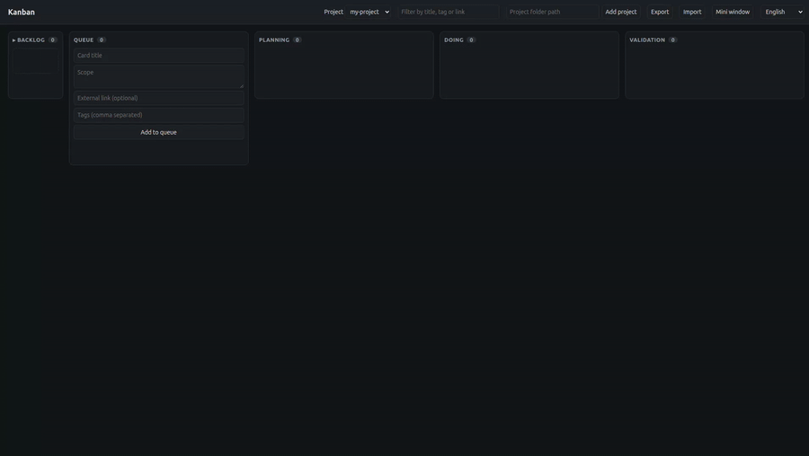
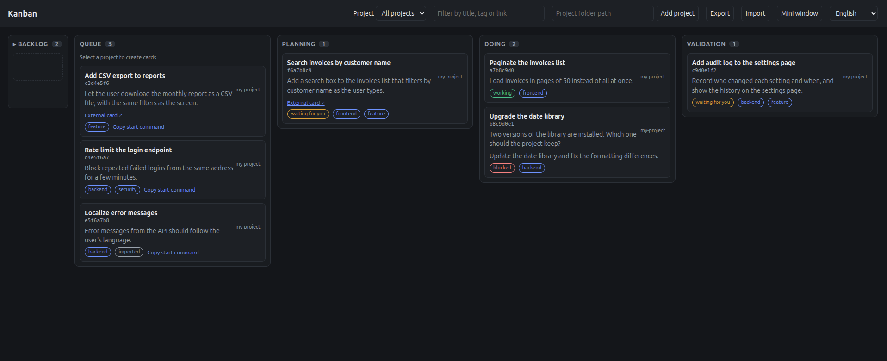
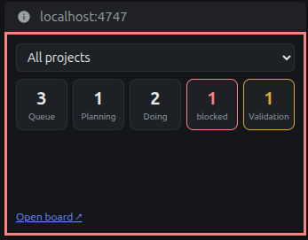

# agent-board

**A local kanban board and planning workflow for AI coding agents.** Cards move through `queue → planning → doing → validation` with a plan you approve before any code is written, in a live web UI. Everything stays on your machine: no account, no cloud.

[](https://github.com/nfekted/agent-board/actions/workflows/ci.yml)
[](LICENSE)



agent-board is a [Claude Code](https://claude.com/claude-code) plugin. It bundles a skill that teaches the agent the workflow, slash commands, an [MCP](https://modelcontextprotocol.io) server that exposes the board as tools, and a small local daemon that serves the board UI.

## Why

Agents are good at doing one thing at a time and bad at remembering what you asked for ten minutes ago. agent-board gives the work a shared, visible state:

- **You decide what is next.** Cards are ordered by priority; the agent takes the first one.
- **Plan first, code second.** The agent structures the scope, proposes a plan and waits for your approval.
- **You always see where things are.** A live board shows what is queued, planned, in progress, blocked or waiting for your validation.
- **Nothing leaves your machine.** Cards live in a JSON file in your home folder.



## Highlights

- **Five columns:** backlog, queue, planning, doing, validation. The backlog is for parked work (technical debt, ideas) and is never started by the agent on its own.
- **Approved plans.** The plan is reviewed with Claude Code's plan mode and saved next to the card. Prefer to skip it? Choose "execute directly".
- **Branch per card**, named after the card title, created when the work starts.
- **Test steps.** Before a card goes to validation, the agent writes a short numbered checklist of how to check the result. See [docs/test-steps.md](docs/test-steps.md).
- **Blocked state.** When the agent is stuck it marks the card as blocked with the reason, and the board shows it.
- **Tags and filter.** Free tags on cards and a header filter over title, tags and link. See [docs/tags-and-filter.md](docs/tags-and-filter.md).
- **Drag to prioritize.** Reorder inside a column or drop between cards of another column. See [docs/ordering.md](docs/ordering.md).
- **Export and import** cards (with their plans) to hand work over to someone else, or import a plain notes file. See [docs/export-import.md](docs/export-import.md).
- **External links.** Attach the ticket URL to a card and open it from the board.
- **Mini window.** A small always-on-top window with one counter per state. See below.
- **English and Portuguese (pt-BR)** UI, light and dark themes.

## Install

Requirements: [Claude Code](https://claude.com/claude-code) and Node.js 20 or newer.

```
/plugin marketplace add nfekted/agent-board
/plugin install agent-board@agent-board
```

Choose the **user** scope to use the board in every project. Restart Claude Code if asked, then open the board:

```
/agent-board:kanban
```

The plugin ships a single-file build, so there is nothing to compile.

## Usage

Talk to Claude naturally ("create a card for the CSV export", "start card 123", "finish card 123") or use the commands:

| Command | What it does |
| --- | --- |
| `/agent-board:kanban` | Opens the board in the browser and summarizes the cards of the current project |
| `/agent-board:new <title> [scope] [link: url]` | Creates a card in the queue |
| `/agent-board:start <title>` | Starts a card: planning, then doing |
| `/agent-board:finish <title>` | Removes a finished card (and its plan file). Does not commit |
| `/agent-board:import <file>` | Creates cards from a `.md` notes file or a `.kanban.json` export |
| `/agent-board:export <name> [titles...]` | Exports cards to a file someone else can import |
| `/agent-board:stop` | Stops the daemon; the board goes offline until the next command |

Cards are identified by title (`123`) or by the id shown on the card, and a unique prefix of three or more characters is enough.

### The flow

1. **Create** a card in the queue (or the backlog), from the board or from Claude.
2. **Start** it. Claude structures the scope if you want, asks for extra context and asks whether to plan or execute directly.
3. **Plan.** You review and approve the plan. Only then does the card move to `doing`, on its own branch.
4. **Validate.** Claude moves the card to `validation` with a summary and the test steps. Ask for adjustments and it goes back and forth until you are happy.
5. **Commit and finish** only when you say so. agent-board never commits, pushes or deletes anything on its own.

Cards belong to a project: the git root, or the folder Claude was opened in. A project also shows the cards of the folders inside it.

### Importing from a notes file

```markdown
## Add CSV export
link: https://tracker.example/123
project: my-app
tags: feature, reports
Let the user download the monthly report as a CSV file.

## Rate limit the login endpoint
status: backlog
Block repeated failed logins from the same address.
```

Optional lines: `link:` (or `url:`), `project:`, `tags:` and `status: backlog`. Without `project:`, cards go to the current project.

## The board

The UI is served by the local daemon at `http://127.0.0.1:<port>/` and updates live.

- Click a card to edit it in a side panel (expandable to full screen for long scopes).
- A colored edge shows what needs you: red for blocked, amber for waiting on you, green for in progress.
- Every card has a **Move to…** menu, so everything works from the keyboard too.
- Projects are added with `+` and removed with the trash icon once they have no cards.
- **Share ▾** has Export and Import. **⚙** has language and theme.

### Mini window



A small window that stays on top while you work: one counter per state, red when a card is blocked and amber when something waits for validation. It uses the browser's Document Picture-in-Picture API, so it only works in Chromium-based browsers (Chrome, Edge, Brave), needs the board tab to stay open, and "always on top" depends on your window manager. Details in [docs/mini-window.md](docs/mini-window.md).

## Good to know

- **Plan mode prompts.** In Claude Code's plan mode, every MCP call that is not read-only asks for confirmation, and allow rules are ignored there. While planning you will be asked to approve board updates such as `kanban_update`. Outside plan mode there is no prompt.
- **Your `CLAUDE.md` wins on style.** The skill follows your project's `CLAUDE.md` for language, tone and commit conventions, but keeps its own safety gates (plan approval and the confirmations before commit, push, finish and delete) unless your file names that step explicitly.
- **Customizing how scopes are structured.** Ask Claude to customize the scope format and it copies the default instruction to `~/.kanban/format-instruction.md` for you to edit. Your file replaces the default.

## Configuration

| Variable | Default | Purpose |
| --- | --- | --- |
| `KANBAN_HOME` | `~/.kanban` | Where the board data lives |
| `KANBAN_PORT` | random free port | Fixed port for the daemon |

Data in `KANBAN_HOME`: `board.json` (cards and projects), `plans/` (plan files), `daemon.json` (running daemon) and an optional `format-instruction.md`. Do not edit `board.json` by hand while the daemon runs.

## How it works

```
Claude Code ──(skill + commands)──▶ MCP server (stdio) ──HTTP──▶ daemon ──▶ ~/.kanban/board.json
                                                                   │
                                          browser ◀── web UI ◀─────┘ (live updates)
```

- The **MCP server** is a thin client started by Claude Code. It starts the daemon on first use.
- The **daemon** is the only process that writes the board file, so concurrent sessions never corrupt it. It listens on `127.0.0.1` only and rejects requests with a foreign `Host` or `Origin`.
- The **UI** is a small Preact app served by the daemon.

## Development

```
npm install
npm run build     # compile all packages
npm test          # core, server and mcp tests
npm run bundle    # build + write plugin/dist, the single-file build the plugin ships
```

`plugin/dist` is committed on purpose, so the plugin installs without compiling. Run `npm run bundle` and commit the result whenever you change anything in `packages/`.

| Path | What it is |
| --- | --- |
| `packages/core` | Card model, state machine, bundle format |
| `packages/server` | Daemon: board service, HTTP API, static UI |
| `packages/mcp` | MCP server and the single-file entry point |
| `packages/ui` | Web UI (Preact + Vite) |
| `plugin/` | The Claude Code plugin: skill, commands, `.mcp.json`, `dist/` |
| `docs/` | Notes on individual features |

Test the plugin from source without installing it: `claude --plugin-dir ./plugin`. Use `KANBAN_HOME` and `KANBAN_PORT` to keep test data away from your real board.

## License

[MIT](LICENSE)
